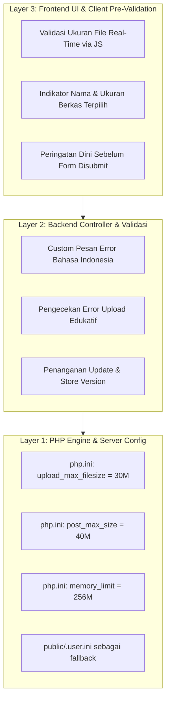

# Implementation Plan: Penyelidikan & Perbaikan Masalah Upload PDF Manual Book ("The pdf file failed to upload")

Penyelidikan mendalam telah dilakukan terkait pesan validasi **"The pdf file failed to upload"** saat pengguna mengunggah berkas PDF untuk Manual Book pada fitur **Kelola Dokumentasi**.

---

## 🔍 Hasil Penyelidikan & Akar Masalah (Root Cause Analysis)

### 1. Asal Usul Pesan `"The pdf file failed to upload"`
Pesan error tersebut bukan berasal dari kecurigaan keamanan berkas, melainkan pesan bawaan (*default translation*) framework Laravel untuk aturan validasi:
```php
'uploaded' => 'The :attribute failed to upload.'
```
Karena nama input berkas adalah `pdf_file`, Laravel memformatnya menjadi `"The pdf file failed to upload."`.

### 2. Mengapa Aturan `'uploaded'` Terpicu?
Pada controller [`app/Http/Controllers/Admin/DocumentationManagementController.php`](file:///c:/Users/PDETUF/Project/Rumah%20Sakit/rbakardinah/app/Http/Controllers/Admin/DocumentationManagementController.php):
```php
$validated = $request->validate([
    ...
    'pdf_file' => 'nullable|file|mimes:pdf|max:20480', // 20MB
]);
```
Saat berkas diunggah, Laravel pertama kali menjalankan pengecekan internal `$file->isValid()`. Jika PHP engine mengembalikan kode error unggah apapun selain `UPLOAD_ERR_OK` (0) — seperti `UPLOAD_ERR_INI_SIZE` (1) — method `$file->isValid()` bernilai `false`.
Ketika bernilai `false`, Laravel **tidak mengecek** aturan `mimes:pdf` ataupun `max:20480`, melainkan langsung memicu kegagalan aturan **`'uploaded'`**.

### 3. Konfigurasi `php.ini` Aktif
Pemeriksaan pada konfigurasi aktif PHP (`C:\php-8.5.9-Win32-vs17-x64\php.ini`) menemukan batas berikut:
- **`upload_max_filesize = 2M`** (hanya 2.097.152 bytes)
- **`post_max_size = 8M`**
- **`memory_limit = 128M`**

### 4. Mengapa Berkas "1,95 MB" Ditolak?
Berdasarkan pengujian langsung pada SAPI HTTP server:
- Tepat `2.097.152 bytes` (2.00 MB exact) -> `UPLOAD_ERR_OK` (Lolos).
- `2.097.153 bytes` (2.00 MB + 1 byte) -> `UPLOAD_ERR_INI_SIZE` (Ditolak PHP).
- Berkas yang diindikasikan berukuran "1,95 MB" pada sebagian file manager / browser seringkali memiliki ukuran biner riil mendekati atau melebihi 2.097.152 bytes (misalnya 2.050 KB = 2.099.200 bytes, yang sebenarnya hanya selisih beberapa kilobyte).
- Yang paling krusial: Sistem menjanjikan pada antarmuka pengguna (`version-form.blade.php`) dan controller bahwa batas berkas adalah **20 MB (`max:20480`)**. Namun karena `php.ini` dibatasi pada **2M**, maka **seluruh berkas PDF manual book di atas 2 MB (misal 3MB, 5MB, 10MB, atau 19MB) dipastikan 100% gagal diunggah**.
- Selain itu, jika ukuran berkas melebihi `post_max_size` (8MB), PHP akan membuang seluruh isi request POST sehingga mengakibatkan error *419 Page Expired* / *CSRF token mismatch*.

---

## 🛠️ Rencana Solusi Komprehensif (3-Layer Fix)

Untuk menyelesaikan masalah ini secara tuntas dan menjamin tidak ada regresi pada fitur lain, perbaikan dilakukan pada 3 layer:



---

## 📋 Rincian Langkah Implementasi

### 1. Penyesuaian Konfigurasi PHP Engine (`php.ini` & `.user.ini`)
- **File**: `C:\php-8.5.9-Win32-vs17-x64\php.ini`
  - Ubah `upload_max_filesize = 2M` menjadi `upload_max_filesize = 30M`.
  - Ubah `post_max_size = 8M` menjadi `post_max_size = 40M` (wajib lebih besar dari `upload_max_filesize` untuk menampung field input form lainnya).
  - Ubah `memory_limit = 128M` menjadi `memory_limit = 256M`.
- **File**: `public/.user.ini`
  - Buat file `public/.user.ini` berisi direktif yang sama sebagai pengaman tambahan untuk server FastCGI/CGI.

### 2. Penyempurnaan Controller & Pesan Validasi
- **File**: [`app/Http/Controllers/Admin/DocumentationManagementController.php`](file:///c:/Users/PDETUF/Project/Rumah%20Sakit/rbakardinah/app/Http/Controllers/Admin/DocumentationManagementController.php)
  - Tambahkan custom error messages berbahasa Indonesia pada `storeVersion` dan `updateVersion`:
    ```php
    $messages = [
        'pdf_file.uploaded' => 'Berkas PDF gagal diunggah. Ukuran berkas melebihi batas server atau koneksi terputus. Pastikan ukuran berkas tidak melebihi 20MB.',
        'pdf_file.max' => 'Ukuran berkas PDF tidak boleh melebihi 20MB.',
        'pdf_file.mimes' => 'Berkas yang diunggah harus berupa dokumen PDF resmi (.pdf).',
        'version.required' => 'Nomor versi wajib diisi.',
        'title.required' => 'Judul dokumen rilis wajib diisi.',
        'released_at.required' => 'Tanggal rilis wajib diisi.',
    ];
    ```
  - Tambahkan inspeksi eksplisit sebelum validasi jika terjadi request POST kosong akibat melebihi `post_max_size`, sehingga sistem memberikan respon informatif alih-alih crash.

### 3. Peningkatan Antarmuka & Validasi Sisi Klien (Frontend UX)
- **File**: [`resources/views/admin/documentation/version-form.blade.php`](file:///c:/Users/PDETUF/Project/Rumah%20Sakit/rbakardinah/resources/views/admin/documentation/version-form.blade.php)
  - Pasang script AlpineJS / JavaScript pada input `#pdf_file`:
    - Validasi ukuran berkas langsung di browser saat pengguna memilih file (`e.target.files[0].size`).
    - Jika ukuran file > 20 MB (20 * 1024 * 1024 bytes), tampilkan alert visual dan reset input file.
    - Tampilkan pill informasi ukuran file yang dipilih, misalnya: *"File dipilih: manual_book_2026.pdf (1.95 MB)"* beserta badge status valid.

### 4. Pengujian & Verifikasi (Automated Testing)
- **File**: [`tests/Feature/Admin/DocumentationManagementTest.php`](file:///c:/Users/PDETUF/Project/Rumah%20Sakit/rbakardinah/tests/Feature/Admin/DocumentationManagementTest.php)
  - Tambahkan test upload PDF berukuran besar (misal 5 MB dan 15 MB) untuk memastikan lolos validasi dan tersimpan ke disk `public`.
  - Tambahkan test untuk memverifikasi pesan bahasa Indonesia saat upload PDF gagal atau melebihi limit.
  - Jalankan seluruh test suite (`php artisan test`) untuk memastikan tidak ada dampak pada modul lain.

---

## 🧪 Rencana Verifikasi

| Skenario Pengujian | Hasil yang Diharapkan |
| :--- | :--- |
| Unggah PDF berukuran 1,95 MB s/d 15 MB | Berhasil disimpan ke `storage/app/public/documents`, status sukses, metadata ukuran berkas tercatat rapi |
| Unggah berkas PDF > 20 MB di browser | Muncul peringatan langsung di form sisi klien sebelum submit |
| Pengujian batas `upload_max_filesize` di `php.ini` | `php -r "echo ini_get('upload_max_filesize');"` bernilai `30M` |
| Seluruh automated test suite | Lulus 100% tanpa error regresi |

---

## 📁 Lokasi Dokumentasi
Rencana ini juga diarsipkan pada:
[`documentation/20260930154000_implementation_plan_Fix_Upload_PDF_Manual_Book_Limit.md`](file:///c:/Users/PDETUF/Project/Rumah%20Sakit/rbakardinah/documentation/20260930154000_implementation_plan_Fix_Upload_PDF_Manual_Book_Limit.md)
