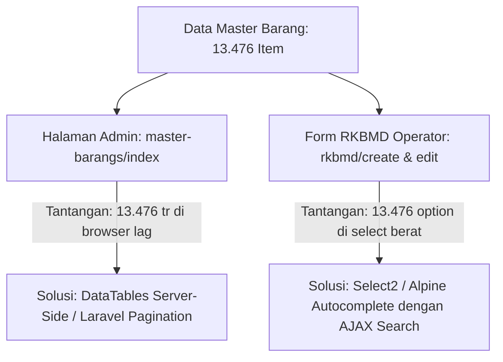

# Implementation Plan: Impor Master Data Barang Level 7 dari Permendagri No. 108 Tahun 2016 ke Tabel Master Barang

Dokumen ini memuat analisis teknis mendalam dan rencana implementasi impor katalog barang dari berkas [tabel_2_6_sub_sub_rincian_objek.json](file:///c:/Users/PDETUF/Project/Rumah%20Sakit/rbakardinah/data/permendagri_108_2016/tabel_2_6_sub_sub_rincian_objek.json) ke dalam tabel `master_barangs` pada modul RKBMD aplikasi SIPAKAR.

---

## 1. Hasil Analisis Data Sumber (`tabel_2_6_sub_sub_rincian_objek.json`)

Pemeriksaan komprehensif terhadap file JSON sumber menghasilkan temuan berikut:

### A. Struktur & Distribusi Hierarki Data
| Level Hierarki | Nama Klasifikasi Permendagri | Jumlah Data | Keterangan |
| :--- | :--- | :--- | :--- |
| **Level 1** | Akun (misal: `1` = ASET) | 1 item | Header penggolongan induk |
| **Level 2** | Kelompok (misal: `1.1` = ASET LANCAR, `1.3` = ASET TETAP) | 3 item | Header kelompok aset |
| **Level 3** | Jenis (misal: `1.1.7` = PERSEDIAAN, `1.3.2` = PERALATAN DAN MESIN) | 13 item | Header jenis barang |
| **Level 4** | Objek (misal: `1.3.2.07` = ALAT KEDOKTERAN DAN KESEHATAN) | 48 item | Header kelompok objek |
| **Level 5** | Rincian Objek (misal: `1.3.2.07.01` = ALAT KEDOKTERAN UMUM) | 158 item | Sub-kategori |
| **Level 6** | Sub Rincian Objek (misal: `1.3.2.07.01.01.01` = Bahan Bangunan) | 980 item | Golongan rincian |
| **Level 7** | **Sub-Sub Rincian Objek** (misal: *Tensimeter*, *Aspal*, *Ambulance*) | **13.476 item** | **Unit Barang Fisik Riil (Target Impor)** |
| **Total** | | **14.679 item** | |

> **Kesimpulan Target Impor**:
> Sesuai arahan pengguna, hanya data **Level 7** (sebanyak **13.476 baris**) yang diimpor sebagai item master barang operasional RKBMD. Level 1 s.d. Level 6 adalah nama kelompok/kategori dan dapat disematkan ke dalam kolom `deskripsi` sebagai jejak hierarki kategori barang.

---

### B. Temuan Khusus: 16 Pasang Kode Duplikat pada Level 7 Regulasi Asli
Dari 13.476 baris Level 7, terdapat **13.460 kode unik** dan **16 pasang kode duplikat** (total 32 baris data).
Penyebabnya adalah pada naskah cetak resmi Permendagri No. 108 Tahun 2016 (hlm. 214–216, sub-kelompok Meja & Kursi Pejabat), Kementerian Dalam Negeri memberikan kode angka yang sama dengan membedakannya melalui tanda apostrof/petik (misal `'001`, `'002'`).
Contoh:
- `1.3.2.05.03.04.002` (baris 1): *Kursi Rapat Pejabat Eselon I/Wakil Gubernur...*
- `1.3.2.05.03.04.002` (baris 2): *Kursi Rapat Ruangan Rapat Ketua/Wakil Ketua DPRD*

> **Poin Kunci Desain Sesuai Arahan Pengguna**:
> Arahan pengguna: *"namun tidak menjadikan kode dari file tersebut sebagai primary key, hanya sekadar kode referensi saja"*.
> **Keputusan Arsitektur ini SANGAT TEPAT**:
> Karena `kode_permendagri` berstatus sebagai **kode referensi** (kolom biasa dengan indeks non-unik), 16 baris dengan kode regulasi yang sama ini **dapat tersimpan secara aman dan utuh tanpa menyebabkan benturan Primary Key / Unique Constraint Violation**.

---

## 2. Analisis Tabel `master_barangs` Eksisting & Relasi Transaksi

### A. Skema Eksisting Tabel `master_barangs`
```sql
CREATE TABLE `master_barangs` (
  `id` BIGINT UNSIGNED AUTO_INCREMENT PRIMARY KEY, -- Primary Key Default
  `kode_barang` VARCHAR(100) NOT NULL UNIQUE,     -- Kode Barang Unik SIPAKAR
  `nama_barang` VARCHAR(255) NOT NULL,
  `satuan` VARCHAR(50) DEFAULT NULL,
  `deskripsi` TEXT DEFAULT NULL,
  `is_active` TINYINT(1) NOT NULL DEFAULT 1,
  `created_by` BIGINT UNSIGNED DEFAULT NULL,
  `updated_by` BIGINT UNSIGNED DEFAULT NULL,
  `deleted_by` BIGINT UNSIGNED DEFAULT NULL,
  `created_at` TIMESTAMP NULL DEFAULT NULL,
  `updated_at` TIMESTAMP NULL DEFAULT NULL,
  `deleted_at` TIMESTAMP NULL DEFAULT NULL
);
```

### B. Relasi Transaksi RKBMD
Setiap permohonan barang belanja modal/barang pada `rkbmd_items` bertransaksi menggunakan relasi:
$$\text{rkbmd\_items.master\_barang\_id} \longrightarrow \text{master\_barangs.id}$$
Dengan demikian:
1. Kolom `id` (bigint auto-increment) tetap menjadi **Primary Key tunggal** yang mengikat seluruh integritas data permohonan RKBMD.
2. Penambahan kolom `kode_permendagri` tidak akan mengganggu relasi database yang sudah ada (*Zero Regression Guarantee*).

---

## 3. Desain Skema & Pemetaan Data

### A. Penambahan Kolom `kode_permendagri`
Dibuat migrasi baru: `database/migrations/YYYY_MM_DD_HHMMSS_add_kode_permendagri_to_master_barangs_table.php`
- Kolom: `kode_permendagri` VARCHAR(50) NULLABLE.
- Indeks: `INDEX idx_master_barangs_kode_permendagri (kode_permendagri)` untuk mempercepat pencarian data berdasarkan nomor regulasi.

### B. Aturan Pemetaan Field Impor

| Field di `master_barangs` | Sumber dari JSON Level 7 | Logika / Nilai Pengisian |
| :--- | :--- | :--- |
| **`id`** | Database Auto-Increment | Tetap sebagai **Primary Key Default** (1, 2, 3...) |
| **`kode_permendagri`** | `item.kode` | Kode murni Permendagri 108 (contoh: `1.1.7.01.01.01.001`, `1.3.2.07.01.01.005`) |
| **`nama_barang`** | `item.uraian` | Nama/uraian resmi barang dari Permendagri (disanitasi dari karakter anomali OCR) |
| **`kode_barang`** | `item.kode` + Postfix unik | Untuk 13.460 kode unik: sama dengan `item.kode`. Khusus untuk 16 kode duplikat kedua: ditambahkan postfix `.1` (contoh: `1.3.2.05.03.04.002.1`) agar `UNIQUE` constraint `kode_barang` di SIPAKAR tetap terpenuhi 100% |
| **`satuan`** | Penyesuaian Kategori | Default `'Unit'` (atau penyesuaian cerdas: Mebeuler/ATK -> `'Buah'`/`'Rim'`, Bahan -> `'Unit'`/`'Kg'`) |
| **`deskripsi`** | Jalur Kategori Induk | Hierarki nama kelompok barang (contoh: `ASET TETAP > PERALATAN DAN MESIN > ALAT KEDOKTERAN`) |
| **`is_active`** | Konstanta | `1` (Aktif) |
| **`created_at`, `updated_at`** | System Clock | `NOW()` |

---

## 4. Dua Opsi Metode Impor yang Disediakan

Kami menyiapkan 2 metode impor yang dapat dipilih pengguna sesuai kenyamanan operasional:

### Opsi 1: File SQL Mandiri Siap Eksekusi (Disarankan untuk Server Produksi)
- Telah disiapkan file SQL berkinerja tinggi di [data/permendagri_108_2016/populate_master_barangs_from_permendagri.sql](file:///c:/Users/PDETUF/Project/Rumah%20Sakit/rbakardinah/data/permendagri_108_2016/populate_master_barangs_from_permendagri.sql).
- **Karakteristik**:
  - DDL otomatis mengecek apakah kolom `kode_permendagri` sudah ada, jika belum otomatis menambahkan kolom beserta indeksnya.
  - Menggunakan teknik **Multi-Row Insert (Chunk 500 baris per query)** sehingga 13.476 baris selesai dieksekusi hanya dalam **27 query (< 3 detik di MySQL)**.
  - Menggunakan `ON DUPLICATE KEY UPDATE` sehingga idempoten (aman dijalankan berulang kali tanpa membuat duplikasi data).
- **Cara Eksekusi di Server**:
  ```bash
  mysql -u root -p db_rba_hospital < data/permendagri_108_2016/populate_master_barangs_from_permendagri.sql
  ```

### Opsi 2: Artisan Command / Seeder Laravel (Disarankan untuk Lingkungan Development/CI-CD)
- Membuat command artisan: `php artisan rkbmd:import-permendagri` atau Seeder `Permendagri108MasterBarangSeeder.php`.
- Membaca berkas `data/permendagri_108_2016/tabel_2_6_sub_sub_rincian_objek.json` secara streaming/chunked.
- Menampilkan progress bar di terminal:
  ```
  Importing Permendagri 108 Level 7 items [============================] 100% (13,476 / 13,476)
  ```

---

## 5. Pertimbangan Kinerja Antarmuka (Penting untuk Skala 13.476 Data)

Saat data bertambah dari 20 item menjadi **13.476 item**, terdapat 2 area UI yang perlu diperhatikan:



1. **Halaman Kelola Master Barang Admin (`admin/master_barangs/index`)**:
   - Jika me-render 13.476 `<tr>` sekaligus di browser, payload HTML mencapai ~12MB dan browser berpotensi freeze/lambat.
   - **Rekomendasi**: Ubah query controller menjadi pagination standar Laravel (`paginate(25)`) atau DataTables Server-side via AJAX.
2. **Form Penginputan RKBMD Operator (`operator/rkbmd/create`)**:
   - Dropdown barang saat ini memuat `@js($masterBarangs)` ke Alpine.js.
   - **Rekomendasi**: Sediakan endpoint pencarian cepat `/admin/master-barangs/search?q=...` dengan pencarian teks pada `nama_barang`, `kode_barang`, dan `kode_permendagri` (limit 20–50 hasil pencarian teratas).

---

## 6. Tahapan Eksekusi yang Diusulkan

### Tahap 1: Persiapan Database & Migrasi
1. Buat file migrasi Laravel untuk penambahan kolom `kode_permendagri` dan indeksnya pada tabel `master_barangs`.
2. Jalankan `php artisan migrate`.

### Tahap 2: Pembaruan Model & Validasi Controller
1. Tambahkan `kode_permendagri` ke properti `$fillable` pada [MasterBarang.php](file:///c:/Users/PDETUF/Project/Rumah%20Sakit/rbakardinah/app/Models/MasterBarang.php).
2. Tambahkan `scopeSearch` untuk mencari berdasarkan nama, kode barang, maupun kode permendagri.
3. Sesuaikan [MasterBarangController.php](file:///c:/Users/PDETUF/Project/Rumah%20Sakit/rbakardinah/app/Http/Controllers/Admin/MasterBarangController.php) dan validasi formnya.

### Tahap 3: Pembaruan Tampilan Admin
1. Tambahkan kolom **Kode Permendagri 108** pada tabel [index.blade.php](file:///c:/Users/PDETUF/Project/Rumah%20Sakit/rbakardinah/resources/views/admin/master_barangs/index.blade.php).
2. Tambahkan input **Kode Permendagri** pada form [create.blade.php](file:///c:/Users/PDETUF/Project/Rumah%20Sakit/rbakardinah/resources/views/admin/master_barangs/create.blade.php) dan [edit.blade.php](file:///c:/Users/PDETUF/Project/Rumah%20Sakit/rbakardinah/resources/views/admin/master_barangs/edit.blade.php).

### Tahap 4: Eksekusi Impor Data
1. Jalankan proses impor 13.476 data (baik via file SQL yang telah disempurnakan atau via Artisan command).
2. Lakukan verifikasi integritas data:
   - Total baris $\ge 13.476$.
   - Sampel item medis (misal: *Tensimeter*, *Stetoskop*, *Ambulance*) tersimpan dengan benar.
   - Sampel item IT/komputer (misal: *Personal Computer*, *Printer Laserjet*) tersimpan dengan benar.

### Tahap 5: Automated Testing & Verifikasi
1. Jalankan feature test RKBMD (`php artisan test --filter=RkbmdTest`) untuk memastikan alur permohonan barang tidak mengalami regresi.
2. Tambahkan test case untuk verifikasi penyimpanan dan pencarian `kode_permendagri`.

---

## 7. Verifikasi SQL Pasca Impor

Kueri SQL untuk memvalidasi keberhasilan impor di server:
```sql
-- 1. Hitung total master barang yang terdaftar (target: minimal 13.476)
SELECT COUNT(*) AS total_barang, 
       COUNT(kode_permendagri) AS total_dengan_kode_permendagri 
FROM master_barangs;

-- 2. Cek sampel item medis rumah sakit
SELECT id, kode_barang, kode_permendagri, nama_barang, satuan 
FROM master_barangs 
WHERE nama_barang LIKE '%Tensimeter%' 
   OR nama_barang LIKE '%Stetoskop%'
LIMIT 5;

-- 3. Cek sampel 16 item yang memiliki kode regulasi duplikat
SELECT kode_permendagri, COUNT(*) AS jml, GROUP_CONCAT(kode_barang) AS kode_barangs, GROUP_CONCAT(nama_barang SEPARATOR ' || ') AS nama_barangs
FROM master_barangs
GROUP BY kode_permendagri
HAVING jml > 1
LIMIT 5;
```

---

## 📁 Lokasi Dokumentasi
Salinan dokumen perencanaan ini juga diarsipkan pada:
[`documentation/20261023123000_implementation_plan_Impor_Master_Barang_Permendagri_108_Level_7.md`](file:///c:/Users/PDETUF/Project/Rumah%20Sakit/rbakardinah/documentation/20261023123000_implementation_plan_Impor_Master_Barang_Permendagri_108_Level_7.md)
