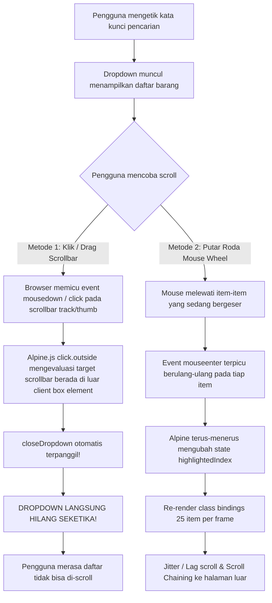
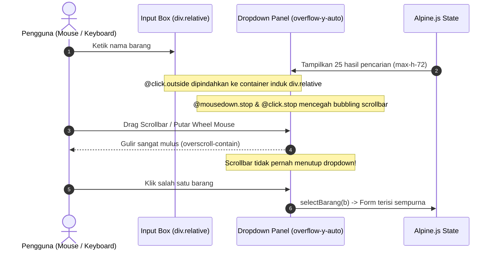

# Implementation Plan: Perbaikan Akses Scroll pada Dropdown Pencarian Barang Formulir RKBMD

Dokumen ini memuat analisis teknis mendalam mengenai penyebab tidak dapat di-scroll-nya daftar barang hasil pencarian pada formulir RKBMD (`operator/rkbmd/create` dan `operator/rkbmd/edit`), serta rencana solusi tuntas agar dropdown hasil pencarian dapat di-scroll dengan sangat mulus baik via **mouse wheel**, **touchpad**, **drag scrollbar**, maupun **navigasi panah keyboard**.

---

## 1. Analisis Akar Masalah (Root Cause & Diagnostics)

Setelah dilakukan penelusuran terhadap komponen combobox di [`resources/views/operator/rkbmd/create.blade.php`](file:///c:/Users/PDETUF/Project/Rumah%20Sakit/rbakardinah/resources/views/operator/rkbmd/create.blade.php) dan [`resources/views/operator/rkbmd/edit.blade.php`](file:///c:/Users/PDETUF/Project/Rumah%20Sakit/rbakardinah/resources/views/operator/rkbmd/edit.blade.php), ditemukan penyebab utama mengapa pengguna merasa "daftar barang tidak bisa di-scroll":



### Rincian Masalah:
1. **Konflik `@click.outside` dengan Scrollbar Browser (Penyebab Utama)**:
   - Pada kode saat ini:
     ```html
     <div x-show="open" @click.outside="closeDropdown()" class="absolute ... max-h-60 overflow-y-auto">
     ```
   - Di browser berbasis Chromium (Google Chrome, Microsoft Edge, Opera) pada sistem operasi Windows, area *scrollbar* elemen `overflow-y-auto` dihitung di luar batas koordinat *content box* elemen tersebut.
   - Ketika pengguna mengklik atau menarik *scrollbar thumb*, directive `@click.outside` Alpine.js mendeteksi bahwa target klik berada "di luar" elemen. Akibatnya, method `closeDropdown()` langsung tereksekusi dan **dropdown tertutup seketika saat pengguna menyentuh scrollbar**.
2. **Ketiadaan `@mousedown.stop` pada Scrollable Container**:
   - Event klik dan penekanan mouse pada scrollbar merambat (*bubble up*) ke *document listener* global Alpine.
3. **Scroll Chaining ke Halaman Luar**:
   - Ketiadaan utility `overscroll-contain` menyebabkan ketika pengguna menggunakan roda *mouse wheel*, browser secara *default* meneruskan momentum gulir ke jendela dokumen utama (*window scroll*) sehingga dropdown tampak "kaku" atau halaman luar yang justru bergeser.
4. **Beban Reaktivitas `@mouseenter` Saat Gulir Cepat**:
   - Penggunaan `@mouseenter="highlightedIndex = bIdx"` memicu puluhan kali perubahan variabel state `highlightedIndex` per detik saat mouse melayang di atas daftar yang sedang digulirkan. Ini menyebabkan *lag* dan *re-flow* pada frame render browser.
5. **Ketinggian Dropdown Terlalu Sempit**:
   - `max-h-60` (hanya 240px) hanya muat menampilkan ~3 item sekaligus, sehingga pengguna sangat bergantung pada *scrolling* untuk melihat item lainnya.

---

## 2. Solusi Desain Arsitektur Baru



### 5 Pilar Solusi:
1. **Pindahkan `@click.outside="closeDropdown()"` ke Container Induk (`div.relative`)**:
   - Dengan meletakkannya pada pembungkus luar yang menaungi kotak input teks sekaligus panel dropdown, interaksi di dalam kotak input maupun pada *scrollbar* dropdown berada di dalam lingkup yang sah (*inside*).
2. **Tambahkan `@mousedown.stop` dan `@click.stop` pada Panel Dropdown**:
   - Menghentikan propagasi event mouse pada *track* atau *thumb scrollbar* ke *listener* luar Alpine.js.
3. **Tambahkan `overscroll-contain`**:
   - Mengunci momentum gulir (*scroll trapping*) tetap berada di dalam dropdown tanpa membocorkan scroll ke halaman latar belakang.
4. **Perluas Ketinggian Maksimum (`max-h-72` / `max-h-80`)**:
   - Dari 240px menjadi 288px–320px, sehingga 5–6 item dapat terlihat langsung dengan nyaman.
5. **Tambahkan Custom Scrollbar Styling Modern**:
   - Memberikan kelas styling scrollbar halus yang jelas terlihat di Windows (lebar 6px, warna slate-300 yang kontras dan rounded), sehingga pengguna sangat mudah melihat dan menyeret scrollbar.
6. **Optimasi Hover Event**:
   - Menghindari pembaruan state reaktif pada event gulir mouse pasif, dan hanya melakukan scrolling otomatis saat navigasi panah keyboard digunakan (`scrollIntoView`).

---

## 3. Rencana Langkah Implementasi

### Langkah 1: Perbarui Formulir Tambah (`operator/rkbmd/create.blade.php`)
Ubah struktur container pencarian barang pada baris item:
```html
<!-- Wrapper Induk dengan @click.outside aman -->
<div x-show="!item.selected_barang" class="relative" @click.outside="closeDropdown()">
    <div class="relative flex items-center">
        <!-- Input Teks Pencarian -->
        <input type="text"
            x-ref="searchInput"
            x-model="query"
            @focus="openDropdown()"
            @input.debounce.250ms="search()"
            @keydown.arrow-down.prevent="highlightNext()"
            @keydown.arrow-up.prevent="highlightPrev()"
            @keydown.enter.prevent="selectHighlighted()"
            @keydown.escape="closeDropdown()"
            placeholder="Ketik kode (1.3.2...) atau nama barang..."
            class="...">
        ...
    </div>

    <!-- Dropdown List Opsi (Aman dari Click Outside saat di-scroll) -->
    <div x-show="open"
        @mousedown.stop
        @click.stop
        x-transition:enter="transition ease-out duration-100"
        x-transition:enter-start="opacity-0 translate-y-1"
        x-transition:enter-end="opacity-100 translate-y-0"
        x-transition:leave="transition ease-in duration-75"
        x-transition:leave-start="opacity-100 translate-y-0"
        x-transition:leave-end="opacity-0 translate-y-1"
        class="absolute z-50 left-0 right-0 mt-1 max-h-72 overflow-y-auto overscroll-contain bg-white border border-slate-200 rounded-xl shadow-xl divide-y divide-slate-100 custom-scrollbar">
        ...
    </div>
</div>
```

### Langkah 2: Perbarui Formulir Edit (`operator/rkbmd/edit.blade.php`)
Terapkan perbaikan arsitektural yang identik pada `resources/views/operator/rkbmd/edit.blade.php`.

### Langkah 3: Tambahkan CSS Utility Scrollbar Halus
Tambahkan styling scrollbar minimalis di bagian `@push('styles')` atau inline style untuk memastikan scrollbar di peramban Windows terlihat jelas, modern, dan nyaman di-drag:
```css
.custom-scrollbar::-webkit-scrollbar {
    width: 6px;
}
.custom-scrollbar::-webkit-scrollbar-track {
    background: #f1f5f9;
    border-radius: 8px;
}
.custom-scrollbar::-webkit-scrollbar-thumb {
    background: #cbd5e1;
    border-radius: 8px;
}
.custom-scrollbar::-webkit-scrollbar-thumb:hover {
    background: #94a3b8;
}
```

---

## 4. Rencana Pengujian & Verifikasi

1. **Uji Drag Scrollbar**:
   - Membuka formulir tambah permohonan RKBMD.
   - Mengetik kata kunci pencarian (misal: "tensi" atau "kertas").
   - Menyeret (*drag*) *scrollbar thumb* ke atas dan ke bawah menggunakan mouse.
   - **Hasil Diharapkan**: Dropdown tetap terbuka 100% dan daftar bergulir dengan lancar tanpa menutup secara mendadak.
2. **Uji Mouse Wheel & Touchpad**:
   - Memutar roda *mouse wheel* pada daftar barang.
   - **Hasil Diharapkan**: Daftar bergulir mulus dan tidak menyebabkan halaman luar meloncat (*overscroll contained*).
3. **Uji Navigasi Keyboard**:
   - Menekan tombol Panah Bawah / Panah Atas untuk memilih item ke-10 atau ke-20.
   - **Hasil Diharapkan**: Kontainer otomatis melakukan *auto-scroll* agar item yang disorot tetap tampak di layar.
4. **Uji Penutupan di Luar (*Click Outside*)**:
   - Mengklik area kosong di luar kotak pencarian dan dropdown.
   - **Hasil Diharapkan**: Dropdown tertutup dengan semestinya.
5. **Uji Regresi Otomatis (Automated Regression Test)**:
   - Menjalankan `php artisan test --filter="RkbmdTest|PermendagriMasterBarangTest"`.
   - Seluruh unit & feature tests tetap lulus 100%.

---

## 📁 Dokumen Rencana
Dokumen rencana ini disimpan di:
- [`documentation/20261024075500_implementation_plan_Perbaikan_Scroll_Combobox_RKBMD.md`](file:///c:/Users/PDETUF/Project/Rumah%20Sakit/rbakardinah/documentation/20261024075500_implementation_plan_Perbaikan_Scroll_Combobox_RKBMD.md)
- Artifact: [implementation_plan.md](file:///C:/Users/PDETUF/.gemini/antigravity-ide/brain/a53b4c36-63b2-4f67-9eb9-e58685591751/implementation_plan.md)
