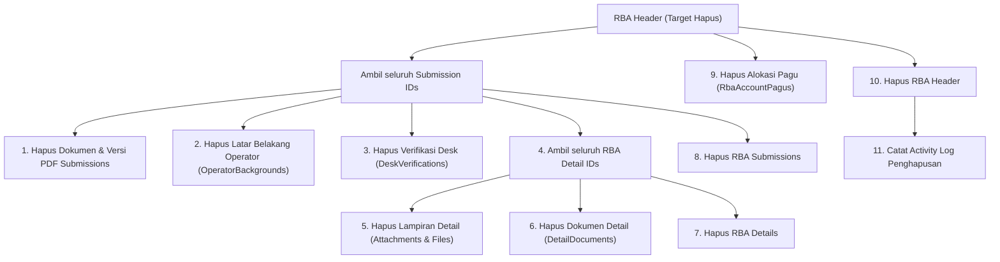

# Implementation Plan: Strategi Penanganan RBA Header Salah Input (Komparasi `is_active` vs `Soft Delete` vs Hard Delete Terkontrol)

Dokumen ini disusun untuk menganalisis dan memberikan rekomendasi solusi paling optimal atas permasalahan adanya **RBA Header yang salah input** di sistem SIPAKAR RSUD Kardinah, di mana Admin telah membuat data RBA Header pengganti yang benar, sementara data yang salah masih menggantung dan berisiko menjadi temuan/pertanyaan pada audit BPK (Badan Pemeriksa Keuangan).

---

## 1. Analisis & Komparasi Strategi Penanganan

Terdapat 3 alternatif pendekatan untuk menangani data RBA Header yang salah:

```
+-------------------------------------------------------------------------------------------------------+
| OPSI 1: Hidden Flag (is_active boolean)                                                               |
| - Menambahkan kolom is_active pada rba_headers, data yang salah ditandai false                        |
| - Dampak Kode: TINGGI (Harus mengubah query di 14+ controller dan views)                              |
| - Audit BPK: RENTAN (Data salah tetap ada di database, memicu pertanyaan penganggaran ganda/batal)   |
+-------------------------------------------------------------------------------------------------------+
| OPSI 2: Soft Delete (SoftDeletes / deleted_at)                                                        |
| - Menambahkan deleted_at pada rba_headers                                                             |
| - Dampak Kode: KRITIS (Bisa memicu fatal error null pointer pada $submission->header di Blade)        |
| - Audit BPK: SEDANG (Data tersimpan dengan timestamp penghapusan)                                     |
+-------------------------------------------------------------------------------------------------------+
| OPSI 3: Hard Delete Terkontrol / Clean Cascade Deletion (REKOMENDASI UTAMA)                            |
| - Menghapus tuntas data RBA salah beserta data turunan kosongnya dalam DB Transaction                 |
| - Mengaktifkan fungsi RbaHeaderController::destroy() dengan validasi pengaman                          |
| - Dampak Kode: NOL / ZERO IMPACT (Tidak mengubah skema database, tidak merusak 1 pun controller lain) |
| - Audit BPK: SANGAT BERSIH (Database rapi, 1 dokumen sah per periode/tahun, tercatat di activity log) |
+-------------------------------------------------------------------------------------------------------+
```

---

### Tabel Matriks Perbandingan Komprehensif

| Kriteria Evaluasi | Opsi 1: Hidden Flag (`is_active`) | Opsi 2: Soft Delete (`SoftDeletes`) | Opsi 3: Hard Delete Terkontrol (Rekomendasi) |
|---|---|---|---|
| **Dampak Perubahan Kode** | **Tinggi** (Perlu menambah `where('is_active', true)` di 14+ controller & view) | **Kritis / Berisiko Bug** (Query anak seperti `RbaSubmission` akan me-load `$submission->header` bernilai `null` dan meledak di Blade) | **Nol (Zero Impact)** (Tidak ada query atau view yang perlu diubah) |
| **Kebutuhan Migrasi Database** | Ya (Tambah kolom `is_active`) | Ya (Tambah kolom `deleted_at`) | **Tidak Perlu** (Skema database tetap murni) |
| **Perspektif Audit BPK** | **Rentan Pertanyaan** (BPK akan melihat 2 RBA di tahun yang sama: *"Mengapa ada RBA nonaktif? Apakah ada anggaran ganda?"*) | **Netral** (Data masih ada di DB, BPK tetap bisa menanyakan riwayat pembatalannya) | **Sangat Bersih & Tertib** (Database 100% konsisten: hanya ada 1 dokumen RBA sah per periode/tahun) |
| **Audit Trail (Jejak Rekam)** | Tersimpan di database | Tersimpan di database | **Tercatat di `activity_logs`** (Lengkap: siapa admin yang menghapus, kapan, dan alasannya) |
| **Kerapihan Database** | Banyak data sampah menggantung | Menyimpan data sampah historis | **Database bersih dan optimal** |
| **Solusi Masa Depan** | Tidak menyelesaikan masalah jika salah input berulang | Rumit dikelola karena relasi berjenjang | **Menyediakan fitur hapus aman di web UI bagi Admin** |

---

## 2. Mengapa Opsi 1 (`is_active`) dan Opsi 2 (`Soft Delete`) Berisiko Merusak Kode Lain?

1. **Jejaring Relasi Berjenjang RBA**:
   Ketika RBA Header dibuat, sistem secara otomatis meng-generate `RbaSubmission` untuk **seluruh unit kerja** (puluhan baris), dan di bawahnya terdapat `RbaDetail`, `RbaAttachment`, `RbaDetailDocument`, `RbaSubmissionDocument`, `RbaSubmissionOperatorBackground`, dan `RbaDeskVerification`.
2. **Risiko Null Pointer Exception pada Soft Delete**:
   - Jika `RbaHeader` di-soft-delete, Eloquent tidak otomatis me-soft-delete `rba_submissions`-nya (karena tabel anak tidak memiliki soft delete).
   - Di menu Operator (`Operator\SubmissionController::index()`):
     ```php
     $submissions = RbaSubmission::with(['header.period'])->where('unit_id', $unitId)->get();
     ```
     Di view Blade:
     ```blade
     {{ $submission->header->year }} - {{ $submission->header->period->name }}
     ```
     Karena headernya di-soft delete, `$submission->header` menjadi **`null`**, sehingga aplikasi langsung mengalami crash:
     `Attempt to read property "year" on null`!
   - Untuk memperbaiki hal ini, kita harus menyisir dan mengubah query di belasan controller agar selalu menyertakan `whereHas('header')`.
3. **Risiko Kebocoran Data pada `is_active`**:
   - Jika menggunakan `is_active`, setiap controller yang lupa ditambahkan `->where('is_active', true)` (misalnya di Dashboard Operator, Supervisor Review, Report Export, atau Pagu API) akan tetap menampilkan RBA yang tidak aktif tersebut.

---

## 3. Rencana Solusi yang Direkomendasikan: Opsi 3 (Hard Delete Terkontrol)

Pendekatan ini memberikan solusi ganda:
1. **Solusi Seketika**: Menghapus data RBA Header yang salah ketik beserta data relasi kosongnya secara tuntas dan aman.
2. **Solusi Jangka Panjang**: Mengimplementasikan method [RbaHeaderController::destroy()](file:///c:/Users/PDETUF/Project/Rumah%20Sakit/rbakardinah/app/Http/Controllers/RbaHeaderController.php#L316-L322) yang saat ini masih kosong, lengkap dengan tombol konfirmasi di antarmuka Admin (`/admin/headers`).

### 3.1 Alur Penghapusan Berjenjang yang Aman (Cascade in Transaction)
Penghapusan akan dieksekusi di dalam `DB::transaction` dengan urutan terbalik dari level terdalam:


### 3.2 Aturan Pengaman (*Safety Guards*)
Untuk mencegah penghapusan yang tidak sengaja terhadap RBA yang sudah berjalan sah:
1. **Pengecekan Transaksi Sah**: Jika RBA Header memiliki rincian belanja yang **sudah divalidasi oleh Supervisor** (`is_validated = true`) atau sudah ada pagu definitif, penghapusan **DITOLAK** dan admin diarahkan untuk membatalkan validasi terlebih dahulu.
2. **Pencatatan Audit Trail BPK**: Setiap penghapusan otomatis dicatat ke tabel `activity_logs` dengan deskripsi lengkap (Nama Admin, ID RBA, Tahun, Periode, dan alasan penghapusan).
3. **Konfirmasi Ganda di UI**: Tombol hapus di halaman Admin Headers mewajibkan pengetikan konfirmasi atau modal peringatan merah yang jelas.

---

## 4. File yang Akan Dimodifikasi

| No | Berkas | Tipe Perubahan | Deskripsi |
|---|---|---|---|
| 1 | [app/Http/Controllers/RbaHeaderController.php](file:///c:/Users/PDETUF/Project/Rumah%20Sakit/rbakardinah/app/Http/Controllers/RbaHeaderController.php) | **Controller** | Mengisi fungsi `destroy()` dengan logika cascading delete berjenjang, validasi keamanan, dan audit log. |
| 2 | [resources/views/admin/headers/index.blade.php](file:///c:/Users/PDETUF/Project/Rumah%20Sakit/rbakardinah/resources/views/admin/headers/index.blade.php) | **Blade View** | Menambahkan tombol "Hapus RBA" dengan modal konfirmasi keamanan di tabel header admin. |
| 3 | [app/Console/Commands/DeleteRbaHeaderCommand.php](file:///c:/Users/PDETUF/Project/Rumah%20Sakit/rbakardinah/app/Console/Commands/) *(Opsional/Utility)* | **Artisan Command** | Perintah CLI `php artisan rba:delete-header {id}` untuk penghapusan langsung via terminal jika diperlukan. |
| 4 | [tests/Feature/Admin/RbaHeaderManagementTest.php](file:///c:/Users/PDETUF/Project/Rumah%20Sakit/rbakardinah/tests/Feature/Admin/) | **Feature Test** | Pengujian otomatis skenario hapus RBA header, cascade delete, proteksi keamanan, dan pencatatan audit log. |

---

## 5. Tahapan Eksekusi

```
Step 1: Identifikasi Data RBA Header yang Salah
  └─ Mengonfirmasi ID RBA Header mana yang hendak dihapus (dan ID RBA yang benar/sah)
  └─ Memeriksa apakah ada file PDF fisik di storage yang perlu dibersihkan

Step 2: Implementasi Logika Penghapusan Berjenjang di RbaHeaderController@destroy
  └─ Bungkus proses dalam DB::transaction
  └─ Validasi safety guard: pastikan tidak ada data belanja tervalidasi yang sah
  └─ Hapus bertahap dari detail_attachments, detail_documents, details, submissions, pagus, hingga header
  └─ Catat ke ActivityLog (Audit trail untuk BPK)

Step 3: Update Antarmuka Admin (admin/headers/index.blade.php)
  └─ Tambahkan tombol "Hapus" berwarna merah di samping "Lock RBA" dan "View Submissions"
  └─ Pasang dialog konfirmasi onsubmit

Step 4: Eksekusi Penghapusan RBA Header yang Salah
  └─ Jalankan penghapusan RBA yang salah melalui perintah aman / web UI
  └─ Pastikan hanya menyisakan RBA Header yang benar

Step 5: Verifikasi & Testing
  └─ Pastikan halaman Operator Submissions, Supervisor Review, Dashboard, dan Reports bersih dan berjalan normal
  └─ Jalankan php artisan test untuk memastikan 100% test hijau tanpa regresi
```

---

## 6. Kriteria Keberhasilan (Success Criteria)

1. **Database Bersih & Tertib BPK**: Hanya terdapat 1 RBA Header yang sah per periode/tahun; data salah input terhapus tuntas tanpa data anak menggantung (*orphaned records*).
2. **Audit Trail Tersedia**: Riwayat penghapusan terekam di `activity_logs` dengan keterangan yang dapat dipertanggungjawabkan kepada BPK.
3. **Zero Regression**: Tidak ada satupun halaman operator, supervisor, admin, maupun laporan yang error atau menampilkan `null`.
4. **Semua Pengujian Lulus**: Seluruh unit & feature tests di aplikasi tetap berstatus **PASS** (100% hijau).

