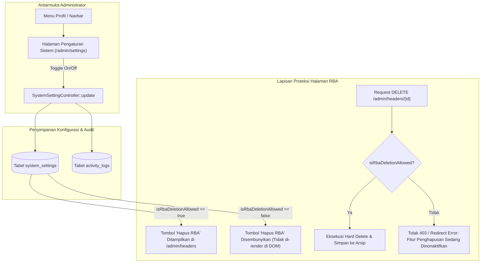

# Rencana Implementasi: Mekanisme Kontrol Visibilitas & Proteksi Tombol Hapus RBA Header

## 1. Analisis Kebutuhan & Perbandingan Pendekatan

Pengguna menghendaki adanya mekanisme untuk menyembunyikan dan menampilkan kembali tombol **"Hapus RBA"** melalui antarmuka khusus di luar halaman daftar RBA Header (`/admin/headers`), agar tombol penghapusan yang berisiko tinggi tersebut tidak terus-menerus terpampang dan tidak sengaja ditekan dalam operasional sehari-hari.

Berikut adalah perbandingan mendalam terhadap 3 pendekatan arsitektur:

### Tabel Perbandingan Pendekatan

| Kriteria Evaluasi | Opsi A: Halaman Pengaturan Admin (`system_settings`) [Rekomendasi Utama] | Opsi B: Variabel Konfigurasi (`.env`) | Opsi C: Panel Kebijakan di Halaman Arsip (`/admin/archives`) |
| :--- | :--- | :--- | :--- |
| **Kemudahan Operasional** | **Sangat Mudah & Mandiri**. Admin RSUD dapat menyalakan saat ingin menghapus, lalu mematikan kembali langsung dari browser. | **Sulit**. Butuh staf IT dengan akses SSH server/CPanel untuk mengedit file `.env` dan me-restart config. | **Mudah**. Admin mengakses dari halaman arsip sampah. |
| **Pemisahan Konteks (Separation)** | **Sangat Baik**. Dikelola di halaman khusus `/admin/settings` (terpisah total dari halaman data operasional). | **Sangat Baik**. Berada di level infrastruktur server. | **Cukup**. Masih dalam lingkup fitur tempat sampah. |
| **Audit Trail BPK** | **Tercatat Sempurna**. Setiap kali tombol diaktifkan/dinonaktifkan, terekam siapa adminnya, kapan, dan dari IP mana di `activity_logs`. | **Tidak Ada**. Perubahan file teks `.env` di server tidak tercatat di database aplikasi. | **Tercatat Sempurna**. Dicatat di `activity_logs`. |
| **Keamanan Backend (Bypass Guard)** | **Ketat**. Endpoint `DELETE` di controller diblokir jika status setting `false` (tidak bisa di-bypass lewat Postman/cURL). | **Ketat**. Diblokir oleh pembacaan `config()`. | **Ketat**. Diblokir oleh pembacaan setting database. |
| **Skalabilitas Masa Depan** | **Sangat Tinggi**. Tabel `system_settings` menjadi modul konfigurasi dasar untuk kebutuhan RSUD lainnya di masa depan. | **Rendah**. Setiap penambahan konfigurasi mengotori file `.env`. | **Rendah**. Bercampur dengan domain data arsip. |

### Pendekatan Hibrida yang Direkomendasikan
Kami merekomendasikan **Opsi A (Halaman Pengaturan Khusus Admin berbasis `system_settings`)** yang didukung dengan:
1. **Fallback ke `.env`**: Jika tabel database belum diatur, sistem membaca default aman (`false`) atau nilai dari `env('ENABLE_RBA_DELETION', false)`.
2. **Backend Guard**: Controller `RbaHeaderController::destroy` menolak request penghapusan jika status setting sedang nonaktif.
3. **Artisan CLI Shortcut**: Perintah `php artisan rba:toggle-deletion {--enable|--disable}` untuk sysadmin yang ingin mengubah via terminal.

---

## 2. Arsitektur & Spesifikasi Perubahan



---

## 3. Rencana Langkah Kerja (Work Steps)

### Langkah 1: Database Migration & Model `SystemSetting`
- Buat migration `database/migrations/xxxx_create_system_settings_table.php`:
  - `id` (bigint, pk)
  - `key` (string, unique, index) — contoh: `'allow_rba_deletion'`
  - `value` (text/nullable) — contoh: `'1'` atau `'0'`
  - `type` (string) — `'boolean'`, `'string'`, dll.
  - `group` (string) — `'security'`, `'general'`
  - `label` (string) — Nama manusiawi setting
  - `description` (text/nullable) — Penjelasan risiko/fungsi
  - `updated_by` (foreign key ke `users.id`, nullable)
  - `timestamps`
- Buat model `app/Models/SystemSetting.php`:
  - Method `static get(string $key, $default = null)`
  - Method `static set(string $key, $value, ?int $userId = null)`
  - Helper khusus: `static isRbaDeletionAllowed(): bool` (mengecek DB, fallback ke `config('rba.allow_deletion', false)`)
- Seeder awal untuk mengisi default `allow_rba_deletion = 0` (nonaktif secara default).

### Langkah 2: Controller & Routing Pengaturan Admin
- Buat controller `app/Http/Controllers/Admin/SystemSettingController.php`:
  - `index()`: Menampilkan antarmuka pengaturan sistem terkelompok (tab/kategori "Keamanan Tindakan Kritis").
  - `update(Request $request)`: Menerima perubahan setting, memvalidasi input, menyimpan ke database, dan mencatat event ke `activity_logs`.
- Daftarkan rute di `routes/web.php` dalam grup admin:
  - `GET /admin/settings` -> `admin.settings.index`
  - `POST /admin/settings` -> `admin.settings.update`

### Langkah 3: Antarmuka Web (Views)
- Buat view `resources/views/admin/settings/index.blade.php`:
  - Desain modern menggunakan Tailwind CSS & Alpine.js.
  - Bagian **"Kebijakan Tindakan Kritis & Penghapusan"**:
    - Kartu Switch Toggle: **"Izinkan Penghapusan RBA Header"**.
    - Badge status visual:
      - 🔴 **Terkunci (Aman)**: Tombol hapus di halaman daftar RBA disembunyikan.
      - 🟢 **Terbuka (Mode Pembersihan)**: Tombol hapus di halaman daftar RBA ditampilkan.
    - Peringatan keamanan: *"Aktifkan fitur ini hanya ketika Anda perlu menghapus RBA Header yang salah input. Matikan kembali setelah proses pembersihan selesai."*
    - Dialog konfirmasi interaktif sebelum switch diubah.
- Tambahkan tautan menu **"⚙️ Pengaturan Sistem"**:
  - Pada dropdown profil pengguna kanan atas di [resources/views/layouts/navigation.blade.php](file:///c:/Users/PDETUF/Project/Rumah%20Sakit/rbakardinah/resources/views/layouts/navigation.blade.php) khusus role `Administrator`.

### Langkah 4: Proteksi Lapisan Tampilan (Blade View RBA Header)
- Perbarui [resources/views/admin/headers/index.blade.php](file:///c:/Users/PDETUF/Project/Rumah%20Sakit/rbakardinah/resources/views/admin/headers/index.blade.php):
  - Bungkus form tombol `Hapus RBA` dengan kondisi:
    ```blade
    @if(\App\Models\SystemSetting::isRbaDeletionAllowed())
        <!-- Form Hapus RBA ke Arsip Sampah -->
    @endif
    ```
  - Jika dinonaktifkan, tombol **sama sekali tidak di-render di HTML**, sehingga tidak dapat dimanipulasi melalui browser DevTools.

### Langkah 5: Proteksi Lapisan Server (Controller Guard)
- Perbarui [app/Http/Controllers/RbaHeaderController.php](file:///c:/Users/PDETUF/Project/Rumah%20Sakit/rbakardinah/app/Http/Controllers/RbaHeaderController.php) pada method `destroy`:
  - Tambahkan guard check di baris teratas:
    ```php
    if (!\App\Models\SystemSetting::isRbaDeletionAllowed()) {
        return redirect()->route('admin.headers.index')
            ->with('error', 'Tindakan penghapusan RBA sedang dinonaktifkan di Pengaturan Sistem. Silakan aktifkan terlebih dahulu melalui menu Pengaturan Sistem.');
    }
    ```
  - Menjamin keamanan mutlak (*zero bypass*) bahkan jika request `DELETE` dikirim melalui tools seperti cURL atau Postman.

### Langkah 6: CLI Artisan Command (Opsional untuk Sysadmin)
- Buat command `app/Console/Commands/ToggleRbaDeletionCommand.php`:
  - Signature: `rba:toggle-deletion {state : enable atau disable}`
  - Memungkinkan sysadmin mengontrol toggle dari terminal server tanpa harus membuka browser.

### Langkah 7: Pengujian Otomatis (Automated Tests)
- Buat Feature Test baru `tests/Feature/Admin/SystemSettingTest.php`:
  - Test 1: Tombol Hapus RBA tidak muncul di halaman `/admin/headers` saat setting nonaktif.
  - Test 2: Request `DELETE /admin/headers/{id}` ditolak (error flash) saat setting nonaktif.
  - Test 3: Admin dapat mengubah setting via `/admin/settings` dan tercatat di `activity_logs`.
  - Test 4: Tombol Hapus RBA muncul saat setting aktif, dan penghapusan berhasil masuk ke arsip.
  - Test 5: Command artisan `rba:toggle-deletion` dapat mengubah nilai setting.

---

## 4. Rencana Verifikasi & Validasi
1. Menjalankan migrasi basis data.
2. Menjalankan pengujian fitur `SystemSettingTest` untuk memastikan seluruh alur aman.
3. Menjalankan seluruh test suite aplikasi (`php artisan test`) untuk memastikan zero regression pada 288 tes yang sudah ada.
4. Membuat berkas panduan/walkthrough.

