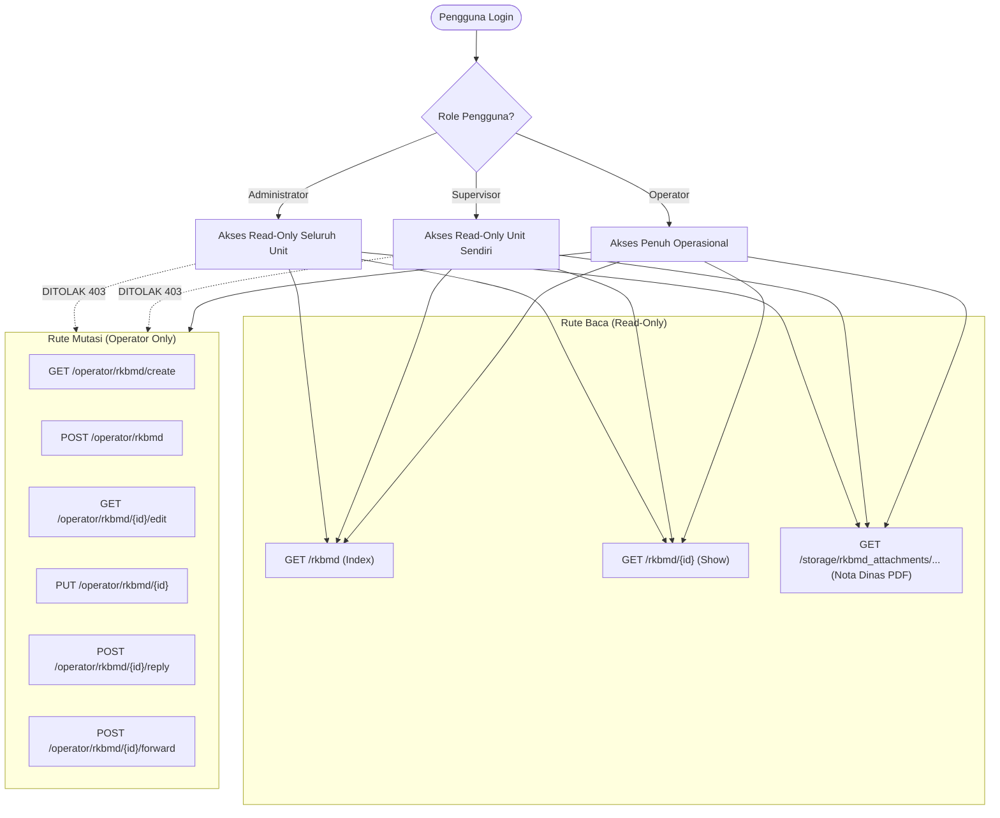

# Rencana Implementasi: Hak Akses Read-Only Fitur RKBMD untuk Supervisor dan Administrator

## 1. Analisis Kebutuhan & Ruang Lingkup

Fitur **RKBMD (Rencana Kebutuhan Barang Milik Daerah)** saat ini hanya dapat diakses oleh pengguna dengan role **Operator** (`middleware(['auth', 'role:Operator'])`). Pengguna menghendaki agar role **Supervisor** dan **Administrator** juga dapat mengakses fitur ini, namun **hanya sebatas read-only** (melihat data dan memantau status tanpa dapat memanipulasi/mengubah data).

### Kebutuhan Tiap Role:

| Role | Cakupan Data (Data Scoping) | Hak Akses | Antarmuka / Tampilan |
| :--- | :--- | :---: | :--- |
| **Administrator** | **Hospital-Wide (Seluruh Rumah Sakit)**: Melihat seluruh permohonan RKBMD dari semua unit dan sub-unit. | **Read-Only** | Tab *"Semua Permohonan RKBMD (Rumah Sakit)"*, filter tambahan Unit Kerja, tanpa tombol buat/edit/balas/alihkan. |
| **Supervisor** | **Unit-Level (Unit Kerja Terkait)**: Melihat permohonan yang **diajukan oleh** sub-unit di bawah unit kerjanya (`unit_id`), serta permohonan yang **ditujukan ke** sub-unit / operator di bawah unit kerjanya (`targetOperator.unit_id`). | **Read-Only** | Tab *"Permohonan Terkait Unit [Nama Unit]"* (dengan indikator status berkas diajukan dari unit vs berkas ditujukan ke unit), tanpa tombol buat/edit/balas/alihkan. |
| **Operator** | **Operasional / Mandiri**: Permohonan yang diajukan sendiri, permohonan masuk ke dirinya, dan permohonan yang dialihkannya. | **Read & Write** (Sesuai alur bisnis) | Tetap memiliki 3 tab operasional (*Permohonan Saya*, *Permohonan Masuk*, *Permohonan Dialihkan*) dan tombol aksi lengkap. |

---

## 2. Arsitektur Proteksi Read-Only (Defense-in-Depth)

Untuk memastikan bahwa Supervisor dan Administrator **benar-benar 100% read-only** dan tidak dapat melakukan mutasi data secara tidak sengaja maupun sengaja (bypass):



### 4 Lapisan Pengamanan (Quad-Layer Security Guard):
1. **Lapisan Rute (Route Middleware)**:
   - Rute `index` dan `show` dibuka untuk `role:Operator,Supervisor,Administrator`.
   - Seluruh rute mutasi (`create`, `store`, `edit`, `update`, `destroy`, `reply`, `forward`, `updateReply`) tetap dikunci dengan `role:Operator`.
2. **Lapisan Controller (Controller Guard)**:
   - Method `create`, `store`, `edit`, `update`, `destroy`, `reply`, dan `forward` pada `RkbmdController` memiliki pengecekan `if (Auth::user()->role !== 'Operator') abort(403);`.
3. **Lapisan Model (Authorization Helpers)**:
   - Pada `RkbmdSubmission`: method `canEditSubmission()`, `canBeManagedBy()`, dan `canEditReply()` secara eksplisit mengembalikan `false` jika user berstatus `Administrator` atau `Supervisor`.
4. **Lapisan Tampilan (Blade Views)**:
   - Tombol *"Buat Permohonan Baru"* disembunyikan jika role bukan `Operator`.
   - Tombol *"Edit Permohonan"*, *"Tanggapi / Balas"*, *"Alihkan"*, dan *"Edit Balasan"* disembunyikan.
   - Ditampilkan badge dan banner informasi *"Mode Peninjauan (Read-Only)"*.

---

## 3. Rencana Langkah Kerja (Work Steps)

### Langkah 1: Pembaruan Routing (`routes/web.php`)
- Pindahkan rute `index` dan `show` RKBMD ke grup bersama:
  ```php
  Route::middleware(['auth', 'role:Operator,Supervisor,Administrator'])->group(function () {
      Route::get('rkbmd', [\App\Http\Controllers\Operator\RkbmdController::class, 'index'])->name('rkbmd.index');
      Route::get('rkbmd/{rkbmd}', [\App\Http\Controllers\Operator\RkbmdController::class, 'show'])->name('rkbmd.show');
      
      // Alias backward compatibility agar tautan dan pengujian lama tetap berjalan mulus
      Route::get('operator/rkbmd', [\App\Http\Controllers\Operator\RkbmdController::class, 'index'])->name('operator.rkbmd.index');
      Route::get('operator/rkbmd/{rkbmd}', [\App\Http\Controllers\Operator\RkbmdController::class, 'show'])->name('operator.rkbmd.show');
  });
  ```
- Pertahankan rute mutasi tetap berada di bawah grup `middleware(['auth', 'role:Operator'])`.

### Langkah 2: Pembaruan Model Authorization (`app/Models/RkbmdSubmission.php`)
- Perketat method:
  - `canBeManagedBy(User $user)`: Hanya role `Operator` yang merupakan target pemegang berkas aktif yang mengembalikan `true`.
  - `canEditSubmission(User $user)`: Hanya role `Operator` pemohon yang dapat mengedit. Hapus izin edit Administrator agar mutlak read-only.
  - `canEditReply(User $user)`: Hanya role `Operator` yang membalas yang dapat mengedit balasan. Hapus izin edit Administrator agar mutlak read-only.

### Langkah 3: Penyesuaian Logika Controller (`app/Http/Controllers/Operator/RkbmdController.php`)
- **Method `index(Request $request)`**:
  - Logika percabangan data sesuai role:
    - **Administrator**:
      - Mengambil semua permohonan rumah sakit: `RkbmdSubmission::with(['applicant', 'subUnit', 'unit', 'items', 'targetOperator', 'repliedBy'])`.
      - Menambahkan filter `unit_id` opsional.
      - Menyiapkan variabel `$units = Unit::orderBy('name')->get()` untuk dropdown filter.
    - **Supervisor**:
      - Mengambil permohonan yang terkait unitnya secara dua arah:
        1. **Diajukan oleh** sub-unit di bawah unit kerjanya (`where('unit_id', $user->unit_id)`), ATAU
        2. **Ditujukan ke** sub-unit / operator di bawah unit kerjanya (`orWhereHas('targetOperator', fn($q) => $q->where('unit_id', $user->unit_id))`).
    - **Operator**:
      - Mempertahankan alur yang ada (`$mySubmissions`, `$incomingSubmissions`, `$forwardedSubmissions`).
- **Method `show(RkbmdSubmission $rkbmd)`**:
  - Memastikan otorisasi melihat:
    - Administrator: Dapat melihat semua permohonan.
    - Supervisor: Dapat melihat permohonan yang berasal dari unitnya (`$rkbmd->unit_id === $user->unit_id`) atau ditujukan ke operator di unitnya.
    - Operator: Pemohon, target operator, atau pihak dalam linimasa riwayat.
- **Method Mutasi**:
  - Pastikan guard `if ($user->role !== 'Operator') abort(403);` aktif di semua method mutasi.

### Langkah 4: Penambahan Menu Navigasi (`resources/views/layouts/navigation.blade.php`)
- Tambahkan link `📦 RKBMD` pada:
  - Menu horizontal desktop Administrator (di samping `RBA Headers`).
  - Menu horizontal desktop Supervisor (di samping `Review RBA`).
  - Menu responsif mobile untuk Administrator dan Supervisor.

### Langkah 5: Penyesuaian Tampilan Index & Show (`resources/views/operator/rkbmd/`)
- **`index.blade.php`**:
  - Bungkus tombol *"Buat Permohonan Baru"* dengan `@if(Auth::user()->role === 'Operator')`.
  - Jika Administrator:
    - Tampilkan tab tunggal *"Semua Permohonan RKBMD (Rumah Sakit)"* dengan badge Unit Kerja dan kolom lengkap.
    - Tambahkan elemen dropdown filter *"Filter Berdasarkan Unit Kerja"*.
  - Jika Supervisor:
    - Tampilkan tab permohonan terkait unitnya dengan badge pembeda yang jelas (misal: *"Diajukan oleh Sub-Unit Kita"* vs *"Ditujukan ke Sub-Unit Kita"*) sehingga Supervisor dapat memantau permohonan keluar maupun permohonan masuk ke unit kerjanya.
  - Jika Operator:
    - Tampilkan 3 tab operasional seperti sedia kala.
- **`show.blade.php`**:
  - Tombol *"Kembali"*: Mengarah ke `route('rkbmd.index')`.
  - Tampilkan banner pemberitahuan *"Mode Peninjauan (Read-Only)"* bagi Administrator dan Supervisor.
  - Sembunyikan semua tombol aksi edit, balas, dan alihkan bagi Administrator dan Supervisor.

### Langkah 6: Pembuatan Pengujian Otomatis (`tests/Feature/General/RkbmdReadOnlyAccessTest.php`)
- Uji skenario lengkap:
  1. `test_admin_can_view_rkbmd_index_and_see_all_hospital_submissions`
  2. `test_supervisor_can_view_rkbmd_index_and_see_submissions_originated_from_and_targeted_to_own_unit`
  3. `test_supervisor_cannot_view_other_unit_rkbmd_detail_in_show`
  4. `test_admin_and_supervisor_can_view_rkbmd_detail_page_and_timeline`
  5. `test_admin_and_supervisor_cannot_access_create_form` (assertStatus 403)
  6. `test_admin_and_supervisor_cannot_submit_store_request` (assertStatus 403)
  7. `test_admin_and_supervisor_cannot_access_edit_form_or_submit_update` (assertStatus 403)
  8. `test_admin_and_supervisor_cannot_reply_or_forward_submission` (assertStatus 403)
  9. `test_operator_retains_full_operational_access_without_regression` (assertStatus 200/Redirect)

---

## 4. Rencana Verifikasi & Validasi
1. Menjalankan pengujian fitur `RkbmdReadOnlyAccessTest`.
2. Menjalankan kembali seluruh 296 pengujian aplikasi (`php artisan test`) untuk memastikan zero regression.
3. Membuat berkas walkthrough dan mempresentasikannya kepada pengguna.
