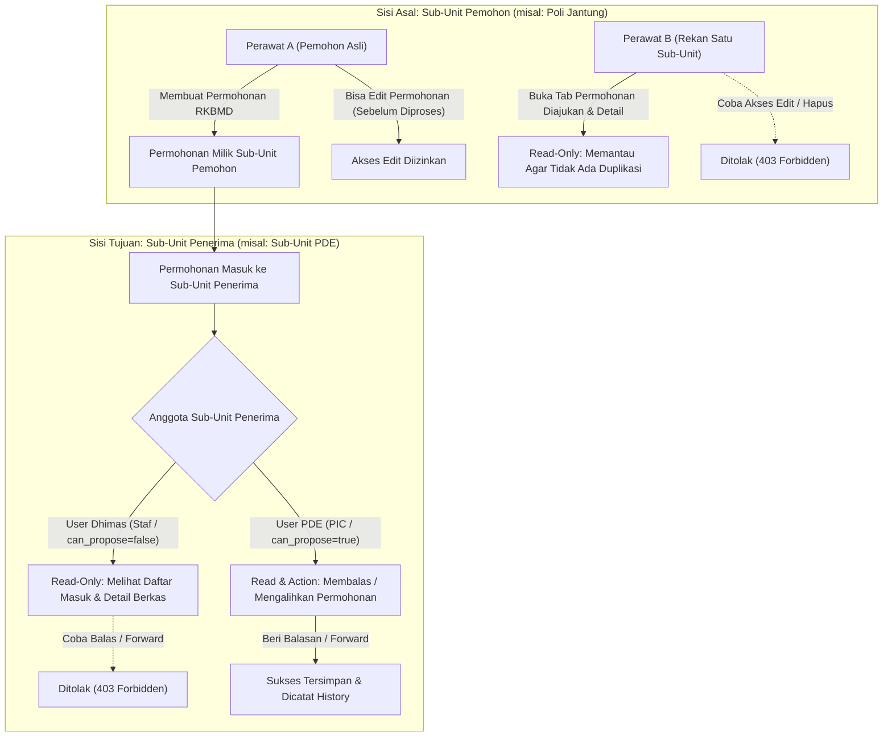

# Implementation Plan: Revisi Permohonan RKBMD Berbasis Sub-Unit Kerja

## 1. Konfirmasi Penyelidikan & Latar Belakang Masalah
Berdasarkan investigasi pada kode sistem saat ini:
- **Pertanyaan Pengguna**: *"Jadi untuk saat ini permohonan langsung tertuju ke user PIC, kah?"*
- **Jawaban**: **Ya, betul sekali.** 
  Pada implementasi sebelumnya:
  1. Permohonan RKBMD disimpan dengan mengunci satu akun tertentu melalui kolom `target_operator_id` (User ID dari PIC).
  2. Tab **"Permohonan Masuk"** di controller dan antarmuka diproteksi dengan kondisi `@if($isProposer)` dan query:
     ```php
     $incomingQuery = RkbmdSubmission::where('target_operator_id', $user->id);
     ```
  3. Akibatnya:
     - Pengguna baru seperti **User Dhimas** (yang berada di unit dan sub-unit yang sama dengan User PDE) jika memiliki `can_propose = false`, tab "Permohonan Masuk" disembunyikan secara total.
     - Sekalipun user Dhimas memiliki `can_propose = true`, kueri hanya mencari record di mana `target_operator_id == Dhimas->id`. Karena permohonan ditujukan ke akun User PDE, maka permohonan tersebut **hanya muncul di layar User PDE** dan tidak terlihat sama sekali oleh User Dhimas.

---

## 2. Kebutuhan Bisnis Baru (Target Requirements)

1. **Permohonan Ditujukan ke Sub-Unit Kerja**:
   Permohonan RKBMD secara organisasi ditujukan kepada **Sub-Unit Kerja Tujuan** (misal: Sub-Unit Kerja PDE / Sub-Unit Sarpras / Sub-Unit Farmasi), bukan sekadar milik perorangan.

2. **Visibilitas Tim Satu Ruangan / Sub-Unit (Sub-Unit Wide Visibility - Read Only)**:
   Seluruh operator/staf yang bertugas di Sub-Unit Kerja Tujuan (baik User PIC seperti PDE maupun staf ruangan seperti Dhimas) **dapat melihat** daftar permohonan masuk yang ditujukan ke sub-unit kerjanya di tab **"Permohonan Masuk (Sub-Unit Kita)"** serta dapat membuka halaman detail (`show`).

3. **Kewenangan Aksi Terkunci Eksklusif untuk PIC (Action Authorization - Restriced to PIC)**:
   Hanya **User PIC / Operator Pengusul** dari Sub-Unit Kerja tersebut (`can_propose = true` dan bertugas di sub-unit tujuan) yang memiliki hak untuk:
   - Memberikan keputusan/balasan permohonan (`reply`): *Dipenuhi, Dipenuhi Sebagian, Substitusi, Optimalisasi, Ditolak*.
   - Mengedit balasan (`reply.update`).
   - Meneruskan / mengalihkan berkas permohonan ke sub-unit/PIC lain (`forward`).
   
   Bagi staf non-PIC (seperti User Dhimas):
   - Bersifat **Read-Only**: Tombol balas dan alihkan tidak ditampilkan.
   - Ditampilkan banner keterangan: *"Permohonan Masuk ke Sub-Unit Anda (PIC Penanggung Jawab: [Nama PIC]) - Anda memiliki akses Read-Only"*.
   - Jika mencoba menembak URL endpoint aksi secara langsung, sistem memblokir dengan status `403 Forbidden`.

4. **Sisi Asal Permohonan Berbasis Sub-Unit Kerja (Outbound Visibility)**:
   - Permohonan yang diajukan keluar kini juga dianggap mewakili **Sub-Unit Kerja Pemohon** (didukung oleh kolom `sub_unit_id` dan `unit_id` pemohon yang sudah ada di database).
   - Seluruh rekan operator/staf di sub-unit kerja pemohon yang sama dapat melihat daftar permohonan yang diajukan oleh ruangannya di tab **"Permohonan Diajukan (Sub-Unit Kita)"** (sebelumnya hanya "Permohonan Saya") serta dapat membuka detailnya (`show`). Hal ini mencegah terjadinya pengajuan barang ganda (*duplikasi*) oleh rekan satu ruangan.
   - **Kewenangan Edit Eksklusif untuk Pemohon Asli**:
     - Hanya **User Pemohon Asli** (`$rkbmd->user_id === $user->id`) yang berhak mengubah/mengedit data permohonan (selama status masih `Diajukan`, belum ada balasan, dan belum dialihkan).
     - Rekan satu sub-unit lainnya hanya memiliki hak **Read-Only** (tombol Edit tidak ditampilkan, dan jika membuka URL edit akan ditolak dengan `403 Forbidden`).
     - *Catatan Fitur Hapus*: Sistem saat ini tidak menyediakan fitur hapus permohonan RKBMD (karena RKBMD merupakan berkas registrasi resmi perencanaan yang bernomor unik), sehingga kontrol mutasi difokuskan penuh pada otorisasi Edit.

5. **Kompatibilitas Penuh dengan Data Eksisting di Production**:
   Sistem saat ini sudah memiliki data permohonan yang diajukan ke user PIC. Data ini **tidak boleh rusak atau hilang**. Melalui mekanisme migrasi database backfill, seluruh data permohonan lama otomatis terisi `target_unit_id` dan `target_sub_unit_id` berdasarkan unit/sub-unit dari akun PIC tujuan saat ini.

---

## 3. Arsitektur Teknis & Skema Database

### A. Migrasi Penambahan Kolom Sub-Unit Tujuan
Menambahkan kolom organisasi tujuan di tabel `rkbmd_submissions`:
- `target_unit_id` (foreign key ke `units.id`, nullable)
  > [!NOTE]
  > **Mengapa kolom `target_unit_id` ini diperlukan?**
  > 1. **Acuan Utama bagi Pengguna Supervisor (Inbound Monitoring)**:
  >    Tepat sekali seperti dugaan Anda. Supervisor memiliki cakupan pengawasan di level Unit Kerja Induk (`unit_id`). Dengan adanya `target_unit_id`, kueri Supervisor untuk memantau permohonan masuk ke unit kerjanya menjadi langsung dan instan (`orWhere('target_unit_id', $supervisor->unit_id)`) tanpa harus melakukan relasi join bertingkat ke tabel operator atau sub-unit.
  > 2. **Menangani Operator/Bagian yang Tidak Memiliki Sub-Unit**:
  >    Di rumah sakit, ada beberapa bagian atau instalasi di mana staf/operatornya berada langsung di bawah Unit Induk tanpa pembagian sub-unit operasional (`sub_unit_id` bernilai `null`). Jika permohonan ditujukan ke unit tersebut, maka `target_unit_id` menjadi acuan mutlak karena `target_sub_unit_id` kosong.
  > 3. **Simetri & Integritas Hirarki Organisasi**:
  >    Pada sisi pemohon, sistem mencatat `unit_id` dan `sub_unit_id`. Menyediakan `target_unit_id` dan `target_sub_unit_id` di sisi penerima menjaga simetri struktur data yang memudahkan filter pelaporan, rekapitulasi rumah sakit, dan audit BPK.
- `target_sub_unit_id` (foreign key ke `sub_units.id`, nullable)
- `target_operator_id` tetap dipertahankan sebagai referensi **PIC Penanggung Jawab Berkas**.

### B. Auto-Backfill Data Migration (Aman untuk Data Eksisting)
Di dalam migrasi database, secara otomatis dijalankan query pengisian data lama:
```sql
UPDATE rkbmd_submissions s
INNER JOIN users u ON s.target_operator_id = u.id
SET s.target_unit_id = u.unit_id,
    s.target_sub_unit_id = u.sub_unit_id
WHERE s.target_unit_id IS NULL;
```
Dengan demikian, permohonan yang sudah diajukan ke User PDE di server production akan langsung memiliki `target_sub_unit_id = PDE`, sehingga seketika User Dhimas membuka aplikasi, permohonan tersebut langsung terbaca di tab "Permohonan Masuk"!

---

## 4. Rencana Tahapan Implementasi



### Tahap 1: Database Migration & Model Updates
1. **Migration**:
   - Buat migrasi `add_target_sub_unit_to_rkbmd_submissions_table.php` yang menambahkan `target_unit_id` dan `target_sub_unit_id`, serta menjalankan auto-backfill data eksisting.
2. **Model `App\Models\RkbmdSubmission`**:
   - Tambahkan relasi `targetUnit()` dan `targetSubUnit()`.
   - Update method `canBeManagedBy(User $user)` (Sisi Penerima):
     ```php
     public function canBeManagedBy(User $user): bool
     {
         if ($user->role !== 'Operator') {
             return false;
         }
         if (in_array($this->status, ['Dipenuhi', 'Dipenuhi Sebagian', 'Substitusi', 'Optimalisasi', 'Ditolak'])) {
             return false;
         }
         // Harus merupakan Operator dengan hak pengusulan (PIC / can_propose = true)
         if (!$user->isProposer()) {
             return false;
         }
         // Harus berada di Sub-Unit tujuan yang sama ATAU merupakan target_operator_id langsung
         if ($this->target_sub_unit_id && $user->sub_unit_id === $this->target_sub_unit_id) {
             return true;
         }
         if (!$this->target_sub_unit_id && $this->target_unit_id && $user->unit_id === $this->target_unit_id) {
             return true;
         }
         return $this->target_operator_id === $user->id;
     }
     ```
   - Update method `canEditReply(User $user)` dengan logika serupa (hanya PIC sub-unit tujuan yang boleh mengedit balasan).
   - Pastikan method `canEditSubmission(User $user)` (Sisi Pemohon):
     Hanya mengizinkan **User Pemohon Asli** (`$this->user_id === $user->id`) yang dapat mengedit permohonan. Rekan satu sub-unit pemohon tidak diizinkan mengedit.

### Tahap 2: Penyesuaian Controller (`Operator/RkbmdController.php`)
1. **Method `index`**:
   - **Sisi Asal (`mySubmissions`)**: Kueri diperluas agar menampilkan seluruh permohonan yang diajukan oleh sub-unit kerja user login:
     ```php
     $myQuery = RkbmdSubmission::with(['targetOperator', 'subUnit', 'unit', 'items', 'applicant'])
         ->where(function ($q) use ($user) {
             if ($user->sub_unit_id) {
                 $q->where('sub_unit_id', $user->sub_unit_id)
                   ->orWhere('user_id', $user->id);
             } elseif ($user->unit_id) {
                 $q->where('unit_id', $user->unit_id)
                   ->orWhere('user_id', $user->id);
             } else {
                 $q->where('user_id', $user->id);
             }
         });
     ```
   - **Sisi Tujuan (`incomingSubmissions`)**: Hapus pembatas `@if($isProposer)` sehingga tab "Permohonan Masuk" terbuka untuk seluruh Operator di sub-unit tujuan. Kueri mengambil berkas yang masuk ke sub-unit kerjanya:
     ```php
     $incomingQuery = RkbmdSubmission::with(['applicant', 'subUnit', 'unit', 'items', 'originalOperator', 'targetOperator', 'targetSubUnit'])
         ->where(function ($q) use ($user) {
             if ($user->sub_unit_id) {
                 $q->where('target_sub_unit_id', $user->sub_unit_id)
                   ->orWhere('target_operator_id', $user->id);
             } elseif ($user->unit_id) {
                 $q->where('target_unit_id', $user->unit_id)
                   ->orWhere('target_operator_id', $user->id);
             } else {
                 $q->where('target_operator_id', $user->id);
             }
         });
     ```
2. **Method `show`**:
   - Perbarui pemeriksaan otorisasi `$isParticipant`: Mengizinkan akses lihat jika user berada di Sub-Unit Pemohon (`$rkbmd->sub_unit_id === $user->sub_unit_id`) ATAU Sub-Unit Tujuan (`$rkbmd->target_sub_unit_id === $user->sub_unit_id`).
3. **Method `edit` & `update` (Sisi Pemohon)**:
   - Tetap diproteksi ketat dengan `!$rkbmd->canEditSubmission($user)` sehingga rekan satu ruangan yang bukan pemohon asli akan langsung diblokir `403 Forbidden`.
4. **Method `reply`, `updateReply`, `forward` (Sisi Penerima)**:
   - Tetap diproteksi ketat dengan `!$rkbmd->canBeManagedBy($user)` sehingga hanya User PIC sub-unit yang dapat memproses transaksi.

### Tahap 3: Pembaruan Tampilan Antarmuka (Blade Views)
1. **[resources/views/operator/rkbmd/index.blade.php](file:///c:/Users/PDETUF/Project/Rumah%20Sakit/rbakardinah/resources/views/operator/rkbmd/index.blade.php)**:
   - **Tab 1: "Permohonan Diajukan (Sub-Unit Kita)"**:
     - Menampilkan seluruh permohonan yang diajukan oleh sub-unit pemohon.
     - Menampilkan nama pemohon di baris tabel: *"Pemohon: [Nama User]"*.
     - Jika permohonan dibuat oleh rekan kerja (bukan diri sendiri), tombol aksi langsung adalah "Detail", tanpa tombol "Edit".
   - **Tab 2: "Permohonan Masuk (Sub-Unit Kita)"**:
     - Ditampilkan untuk **seluruh Operator**.
     - Menampilkan nama PIC yang ditugaskan: *"PIC: [Nama PIC]"*.
     - Bagi user non-PIC (seperti Dhimas), tampilkan badge: *"👁️ Akses Pantau (Read-Only)"*.
2. **[resources/views/operator/rkbmd/show.blade.php](file:///c:/Users/PDETUF/Project/Rumah%20Sakit/rbakardinah/resources/views/operator/rkbmd/show.blade.php)**:
   - Tombol "Edit Permohonan" hanya muncul jika `$rkbmd->canEditSubmission(Auth::user())` (eksklusif pemohon asli).
   - Tombol "Beri Keputusan / Balasan" dan "Alihkan Permohonan" hanya muncul jika `$rkbmd->canBeManagedBy(Auth::user())` (eksklusif PIC sub-unit tujuan).
   - Untuk rekan satu sub-unit yang berstatus Read-Only, tampilkan banner informatif yang relevan (baik sebagai rekan sub-unit pemohon maupun rekan sub-unit penerima).
3. **[resources/views/operator/rkbmd/create.blade.php](file:///c:/Users/PDETUF/Project/Rumah%20Sakit/rbakardinah/resources/views/operator/rkbmd/create.blade.php)**:
   - Perjelas label opsi tujuan pada dropdown agar menampilkan nama **Sub-Unit Kerja Tujuan (PIC: [Nama Operator Pengusul])**.

### Tahap 4: Pengujian Otomatis (Automated Testing)
Dibuat test suite baru `tests/Feature/Operator/RkbmdSubUnitTargetTest.php` yang menguji skenario nyata:
1. **Skenario Sisi Tujuan (Inbound)**:
   - Pemohon mengajukan RKBMD ke Sub-Unit PDE.
   - User Dhimas (staf non-PIC di PDE) dapat melihat berkas di tab Permohonan Masuk dan membuka detail `show`.
   - User Dhimas tidak melihat tombol balas/alihkan dan diblokir `403 Forbidden` jika mencoba submit.
   - User PDE (PIC) dapat melihat tombol dan berhasil membalas serta mengalihkan permohonan.
2. **Skenario Sisi Asal (Outbound)**:
   - Perawat A di Poli Jantung mengajukan RKBMD.
   - Perawat B (rekan kerja di Poli Jantung) dapat melihat permohonan tersebut di tab Permohonan Diajukan dan membuka detail `show`.
   - Perawat B tidak melihat tombol edit dan diblokir `403 Forbidden` jika mencoba submit form edit/update.
   - Perawat A (pemohon asli) tetap dapat mengedit permohonan.
3. **Skenario Kompatibilitas Data Eksisting**:
   - Memastikan permohonan lama di production otomatis terpetakan ke sub-unit asal dan sub-unit tujuan secara akurat.
4. Menjalankan full test suite untuk memastikan 0 regresi.

---

## 5. Pertanyaan & Konfirmasi untuk Pengguna
1. Apakah alur di atas sudah sesuai dengan yang Anda harapkan (seluruh operator di sub-unit kerja dapat memantau permohonan masuk secara read-only, namun tindakan balasan/forward hanya boleh dilakukan oleh PIC)?
2. Apakah rencana migrasi auto-backfill untuk data permohonan lama yang sudah ada di production sudah siap untuk kami eksekusi?
